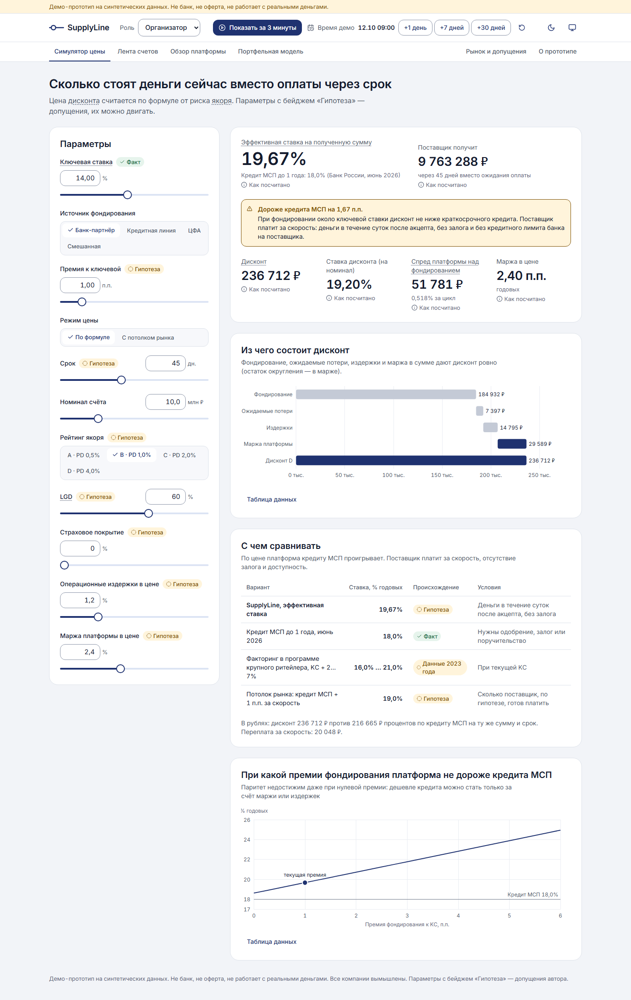

# SupplyLine — демо-прототип

Платформа цифрового реверсивного факторинга для среднего бизнеса (выручка 0,8–2 млрд ₽). Крупный покупатель («якорь») акцептует счёт поставщика, платформа покупает требование со скидкой и платит в течение суток. Цена считается по риску якоря.

**Демо-прототип на синтетических данных. Не банк, не оферта, не работает с реальными деньгами.** Учебный проект; все компании вымышлены.



## Быстрый старт

Нужен Python 3.12+. Node.js 20+ нужен только для сборки интерфейса (в Docker он уже есть).

```bash
python tasks.py demo
```

Сбрасывает базу, генерирует данные (seed 42), собирает интерфейс и поднимает http://127.0.0.1:8000. В шапке кнопка «Показать за 3 минуты» проводит по сценарию показа.

Через Docker, в режиме песочницы на посетителя (как публичное демо):

```bash
docker compose up --build
```

Развёртывание на Render, Amvera или Hugging Face Spaces: [docs/DEPLOY.md](docs/DEPLOY.md).

## Что работает, а что имитация

| Что | Как | Примечание |
|---|---|---|
| Формулы цены, лимиты, скоринг, реестр против двойного финансирования, автомат статусов | Работает | Python-движок, покрыт тестами |
| Финансовая модель на 60 месяцев | Работает | Паритет с Excel-книгой проверяется тестом |
| Лимит концентрации на якоря 15% | Работает | Книга Excel считает стресс при 25%, платформа ограничивает 15%: ниже безопасной доли 16,4% |
| ЭДО, акцепт якоря, платежи, оператор ЦФА | Имитация | Задержка 0,1–0,8 с и сбои по выбору; в фазе 0 меняются только реализации портов |
| Роли «Организатор», «Поставщик», «Якорь», «Инвестор» | Имитация | Переключатель вида, не контроль доступа |
| Компании, счета, платежи | Синтетика | Одинаковые при каждом запуске |
| Премии фондирования, PD, LGD, расходы, оборот | Гипотеза | Каждый параметр помечен бейджем |
| KС, ставки МСП, налог, сроки по 381-ФЗ | Факт | С источником и датой проверки |
| Регуляторное одобрение, реальные деньги, блокчейн, ML-скоринг | Нет | Не делается и не изображается |

## Структура

```
engine/     цена, финмодель (паритет с Excel), скоринг, реестр, лимиты, фондирование, статусы, часы
adapters/   порты ЭДО, акцепта, платежей и ЦФА + имитации
api/        FastAPI; sandbox.py — песочница на посетителя (SUPPLYLINE_SANDBOX=1)
db/         SQLite, модели SQLAlchemy, детерминированный сид
web/        React 18 + TypeScript + Vite + Tailwind на токенах, Radix, TanStack Query, ECharts
tests/      pytest: движок, модель, паритет с Excel, API, песочница, книга v2; e2e — Playwright
scripts/    смоук, e2e, видео, numbers.json, книга v2, PDF аналитики, презентация, скриншоты
docs/       решения, факты, развёртывание, аналитика, дизайн, доступность
```

## Тесты

```bash
SUPPLYLINE_MOCK_LATENCY=0 python -m pytest -q
```

Браузерные сценарии (нужны собранный `web/dist` и `python -m playwright install chromium`):

```bash
python -m pytest -q -m e2e
```

Проверка развёрнутого демо:

```bash
python scripts/smoke.py https://<адрес> --wait 120
```

CI (`.github/workflows/ci.yml`): ruff, pytest с LibreOffice (13 вариантов паритета с книгой), typecheck, сборка интерфейса, e2e, сборка Docker-образа и смоук.

## Материалы Спринта №1

Все числа берутся из одного файла `deliverables/numbers.json`:

```bash
python scripts/export_numbers.py
```

| Материал | Команда |
|---|---|
| Видео-демо 2–3 минуты (сервер запущен) | `python scripts/record_demo.py http://127.0.0.1:8000` |
| Презентация PPTX и PDF | `python scripts/build_deck.py --pdf` |
| Пакет аналитики (PDF + Excel v2) | `python scripts/export_analytics.py` |
| Скриншоты и аудит axe | `python tasks.py screens` |

Текст для озвучки видео: [docs/VIDEO_SCRIPT.md](docs/VIDEO_SCRIPT.md). Аналитика в Markdown: [docs/analytics/](docs/analytics/).

## Честность цифр

- Каждый параметр помечен «Факт» (с источником и датой) или «Гипотеза».
- Факт без открытого первоисточника не выводится на экран: [docs/FACTS_TODO.md](docs/FACTS_TODO.md).
- Числа модели считает только `engine/finmodel.py`; демо-счета и модель независимы.

Решения: [docs/DECISIONS.md](docs/DECISIONS.md) · блокеры: [docs/BLOCKERS.md](docs/BLOCKERS.md) · соответствие Excel → движок: [docs/model/MAPPING.md](docs/model/MAPPING.md) · доступность: [docs/a11y-report.md](docs/a11y-report.md).

## Лицензия

Учебный проект для конкурса. Код можно читать и запускать; использование в коммерческих целях — по согласованию с командой.
